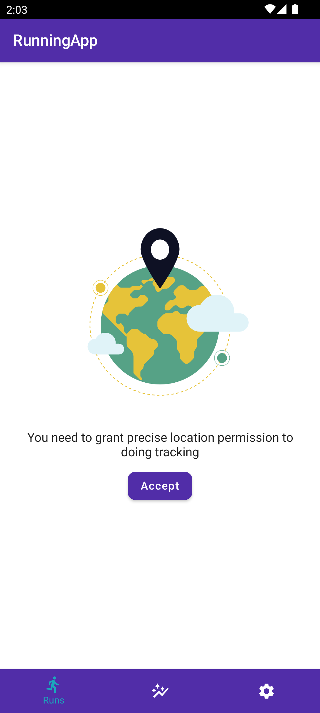
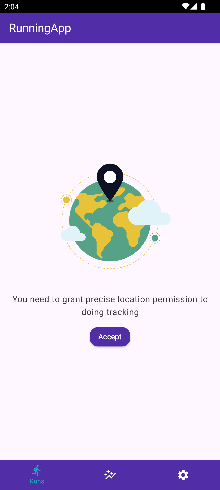
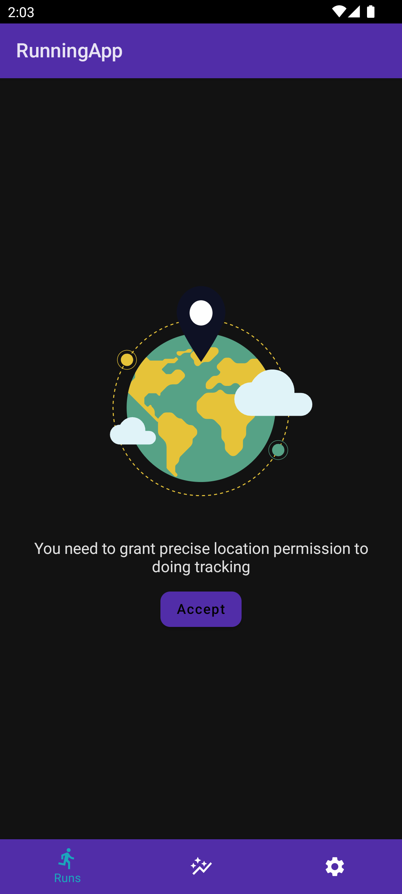
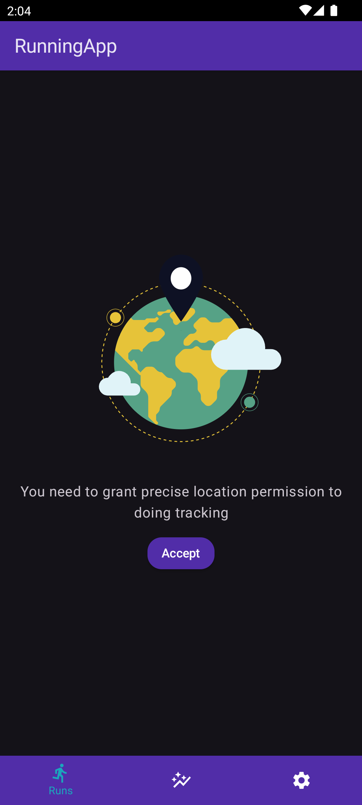
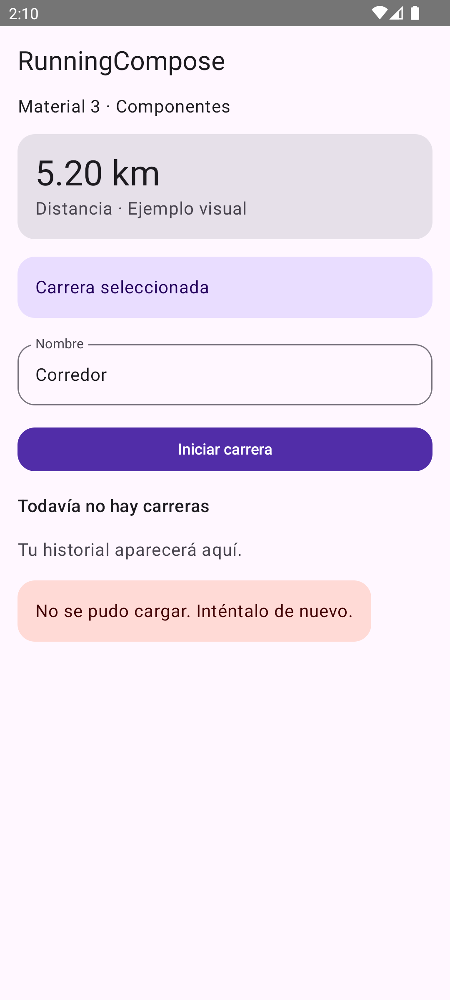
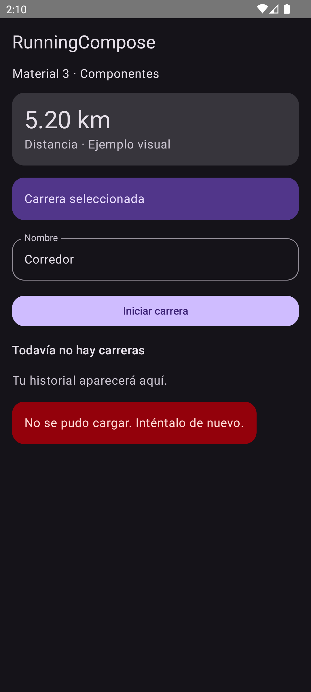
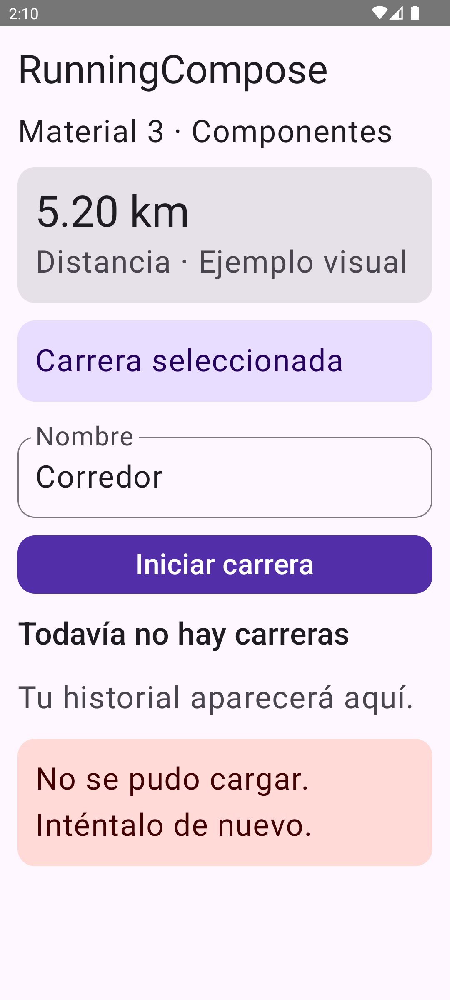
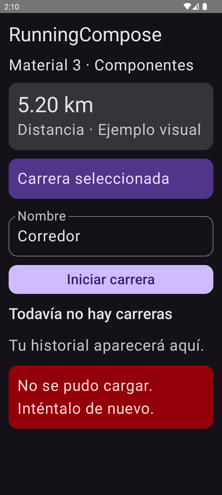

# Material 3 — Fases 1 y 2: implementación y QA

Fecha: 2026-10-10. Entorno: Windows, AVD `Codex_UI_API_33`, Android 13/API 33,
1080×2400, densidad 420. Emulador lanzado durante esta sesión.

## Alcance entregado

- Dependencia Material 3 1.3.2 resuelta por Compose BOM 2025.06.01, sin actualizar
  Kotlin, AGP, Room, Hilt ni otras bibliotecas.
- Esquemas morados completos para ambos modos, sin acentos predeterminados ajenos.
- Formas 16 dp para componentes, 24 dp para contenedores grandes y 8 dp para
  extraSmall. Campo del catálogo explícitamente a 16 dp.
- Tipografía Material 3 y escala de espaciado 4/8/12/16/24/32 dp.
- RunningComposeTheme ofrece M3 y un puente M2: mismos neutros, tipos y formas.
  Los tonos de acción M2 siguen anteriores hasta migrar componentes con blancos
  y negros fijos; no se afirma que toda la app ya esté en Material 3.
- Catálogo de componentes en previews y tests: ejemplos ficticios, no una nueva
  pantalla de producción ni implementación funcional del historial.
- Corrección de un test antiguo que esperaba el namespace en vez del applicationId.

## Pruebas ejecutadas

| Verificación | Resultado |
|---|---|
| Baseline: testDebugUnitTest + assembleDebug | BUILD SUCCESSFUL |
| Build final: testDebugUnitTest + assembleDebug + assembleDebugAndroidTest | BUILD SUCCESSFUL |
| Suite JVM final | 26 tests, 0 fallos/errores |
| RunningThemeTest | 2 tests; contraste de 18 pares semánticos por modo y puente M2 |
| connectedDebugAndroidTest | 5 tests aprobados en API 33 |
| Instrumentación ADB final, sobre APK final | OK (5 tests) |
| Catálogo: claro/oscuro, fuente normal/200% | 4 tests; texto, acción y error visibles, scroll accesible |
| App real: pestañas Carreras, Estadísticas, Ajustes | Navegación manual ADB y capturas |
| Ajustes: fuente 200% y landscape | Capturas inspeccionadas; no constituye auditoría integral |
| Buffer crash de logcat consultado | Sin líneas FATAL/Exception registradas en la consulta |
| git diff --check | Sin errores de whitespace |

El umbral de los pares de texto probados es 4.5:1. No cubre combinaciones
arbitrarias, controles deshabilitados ni garantiza el contraste de todas las
pantallas antiguas. Los tests del catálogo validan composición/visibilidad, no
acciones reales de iniciar una carrera, filtros o eliminación.

Logs locales: `.gradle/ui-baseline.log`, `.gradle/ui-foundation-final.log`,
`.gradle/ui-foundation-connected.log`, `.gradle/ui-foundation-final-instrumentation.log`.
Reportes Gradle: `app/build/reports/tests/testDebugUnitTest/` y
`app/build/reports/androidTests/connected/`.

## Capturas inspeccionadas

### Comparación equivalente: permiso de ubicación pendiente

Antes/después corresponden al mismo estado de la app y a la misma resolución.
El movimiento de la ilustración Lottie puede variar entre capturas.

| Antes | Después |
|---|---|
|  |  |
|  |  |

Cambios apreciables: fondo neutro violeta, mejor separación de roles tipográficos
y geometría compartida. Las barras saturadas permanecen intencionalmente M2.

### Catálogo Material 3 — no es el historial final

| Claro | Oscuro |
|---|---|
|  |  |
|  |  |

Los bloques se distinguen por tono y mantienen texto legible. A 200%, el error
se adapta a varias líneas; los tests desplazan hasta acción/error y verifican
visibilidad. No se observaron solapamientos de esos bloques en las capturas.

### App real después de preparar permisos en el emulador

- [Carreras vacío claro](material3-phase1/after-history-light.png).
- [Carreras vacío oscuro](material3-phase1/after-history-dark.png).
- [Estadísticas vacío](material3-phase1/after-statistics-light.png).
- [Ajustes](material3-phase1/after-settings-light.png).
- [Ajustes fuente 200%](material3-phase1/after-settings-font200.png).
- [Ajustes horizontal](material3-phase1/after-settings-landscape.png).

Se usó perfil ficticio RunnerQA/70 kg, sin carreras guardadas. Los permisos de
ubicación/notificaciones se concedieron por ADB para alcanzar el historial;
esto no valida la interacción con el diálogo de permisos del sistema.
Mapa de ejemplo y ruta de Ajustes visibles tras esperar carga; no se probó GPS real.

## Hallazgos y pendientes

1. La navegación antigua todavía usa morado saturado, selección turquesa y solo
   muestra la etiqueta activa. Reemplazar por NavigationBar tonal en fase 3.
2. Las barras antiguas incluyen foregrounds fijos: migrarlas antes de alinear
   también los tonos de acción del puente M2 al esquema oscuro M3.
3. Los estados vacíos siguen centrados en ilustraciones grandes y dejan mucho
   espacio sin información; el piloto de Carreras debe mejorar su jerarquía/CTA.
4. Ajustes requiere scroll, especialmente en horizontal y al 200%; aún necesita
   validación de todos sus controles inferiores y con teclado. Las capturas no
   prueban que todo el formulario sea accesible. No alterar esa pantalla en esta fase.
5. La app real conserva textos en inglés bajo un entorno con introducción mixta;
   la localización no se cambió en esta entrega.
6. Pendientes: TalkBack, API 36/edge-to-edge, tablet, lista con datos, selección,
   filtros, detalle, tracking/background/recuperación y pruebas con teclado.

## Reproducir las pruebas y capturas del catálogo

1. Lanzar un AVD y ejecutar `gradlew.bat testDebugUnitTest assembleDebug assembleDebugAndroidTest`.
2. Instalar APK debug y androidTest desde `app/build/outputs/apk/`.
3. Ejecutar `adb shell am instrument -w com.nullpointer.running.test/androidx.test.runner.AndroidJUnitRunner`.
4. Extraer capturas de `/sdcard/Android/data/com.nullpointer.running/files/theme-catalog/`.

`connectedDebugAndroidTest` desinstaló los paquetes al acabar en este entorno y
borró sus capturas externas. Se repitió por ADB para extraerlas antes de desinstalar.
Se restauró fuente 1.0, portrait y modo claro tras el QA; emulador y app quedan abiertos.

## Siguiente entrega

Fase 3: shell Material 3 + Carreras. Preservar navegación y selección, definir
propietario de insets y repetir capturas equivalentes y pruebas antes de tracking.
Sin commit, push ni publicación en esta entrega. Cambios locales de IDE y
HomeScreen no fueron sobrescritos.
