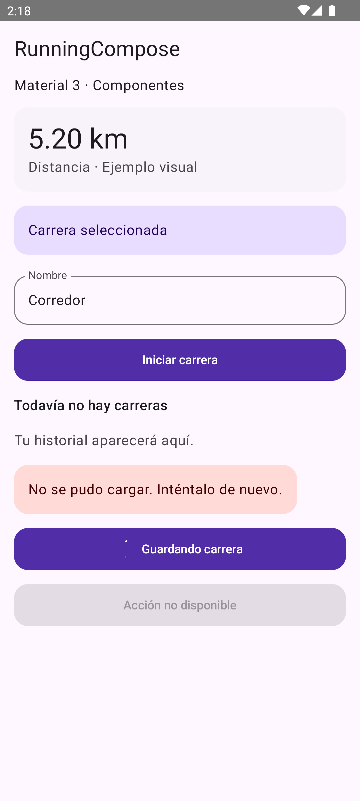
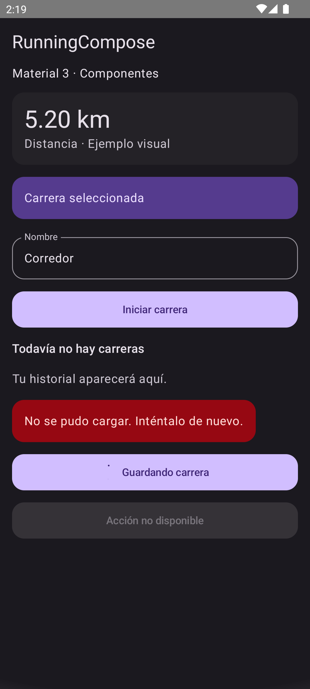
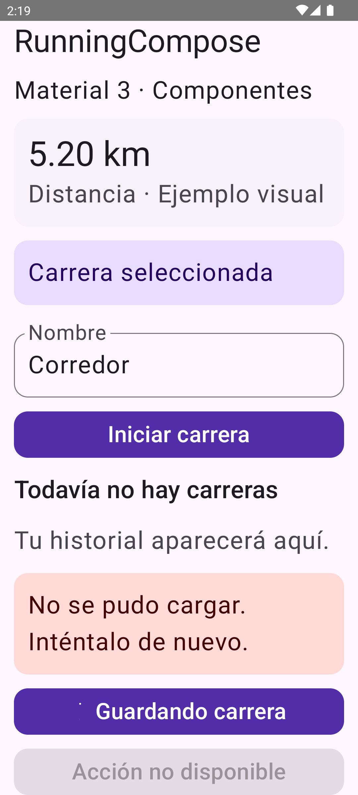
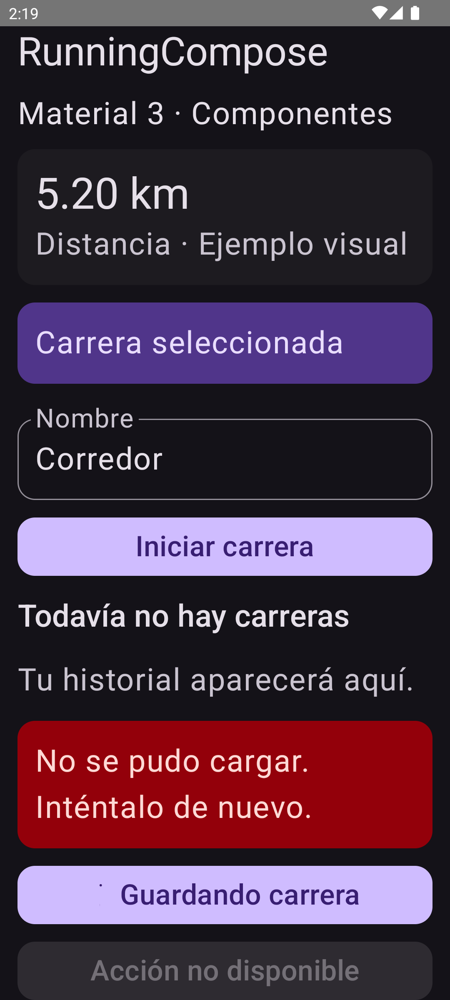

# Fase 2 — Componentes reutilizables Material 3

Fecha: 2026-10-10. Continuación de la fundación del tema; **no es la fase 3**.

## Entregado

`app/src/main/java/com/nullpointer/runningcompose/ui/share/material3/RunningComponents.kt`:

- `RunningCard`: superficie tonal neutra, forma medium y padding compartido.
- `RunningSelectableCard`: estado controlado, callback y semántica de selección.
- `RunningPrimaryButton`: objetivo mínimo 48 dp, estados normal/deshabilitado/carga.
  Mientras carga, bloquea pulsaciones repetidas y anuncia estado localizado.
  Conserva primary/onPrimary para distinguir carga de una acción no disponible.
- `RunningTextField`: valor controlado, label, enabled/readOnly, teclado y error visible.
- `RunningErrorMessage`: errorContainer/onErrorContainer y región viva polite.

El catálogo ahora consume estos componentes y permite editar el nombre y cambiar
la selección. La acción «Iniciar carrera» sigue siendo una muestra, no inicia GPS.
Los componentes no contienen lógica de negocio, acceso a datos ni navegación.
El estado de carga tiene traducción en recursos por defecto y `values-en`.

## Validación final

AVD existente `Codex_UI_API_33`, Android 13/API 33, 1080×2400.

| Prueba | Resultado |
|---|---|
| testDebugUnitTest + assembleDebug + assembleDebugAndroidTest | BUILD SUCCESSFUL |
| Tests JVM | 26 aprobados |
| Instrumentación directa sobre APK final | 10 aprobados |
| Nuevos tests de componentes | 5 aprobados |
| Catálogo claro/oscuro, fuente normal/200% | 4 aprobados |
| git diff --check | Sin errores |
| Consulta del buffer crash | Sin entradas fatales en la consulta |

Los cinco tests nuevos verifican:

1. Acción principal: callback y altura mínima.
2. Acción deshabilitada: no ejecuta callback al tocarla.
3. Acción en carga: semántica localizada y bloqueo de nueva pulsación.
4. Campo: propaga el texto editado y muestra el mensaje de validación.
5. Tarjeta: expone selección, alterna al pulsar y tiene altura mínima de 48 dp.

Logs locales: `.gradle/ui-phase2-components-build.log` y
`.gradle/ui-phase2-components-tests.log`. Se instalaron APKs mediante ADB y se
extrajeron las capturas sin desinstalar los paquetes. La app queda abierta.

## Capturas y análisis

| Claro | Oscuro |
|---|---|
|  |  |
|  |  |

- Tarjetas y campos usan geometría consistente; la selección se distingue por tono.
- La revisión inicial detectó que el botón ocupado parecía una acción no disponible:
  se mantuvo el bloqueo de entrada, pero se recuperó el par primary/onPrimary.
- A 200%, el error adapta sus líneas y los controles inferiores siguen alcanzables
  mediante scroll; los tests comprobaron visibilidad después de desplazar.
- Los grises atenuados se reservan al estado no disponible. No se afirma contraste
  4.5:1 para controles deshabilitados ni cumplimiento global de accesibilidad.
- El indicador animado puede verse como un punto en el frame de captura del test;
  la imagen estática no valida su animación temporal.

## Límites y siguiente fase

No se migraron pantallas reales a estos componentes en esta continuación; el
catálogo es la integración de referencia. Las barras y el historial aún requieren
fase 3. No se tocaron tracking, almacenamiento, rutas, firma ni CI/CD.

Pendientes de la migración: API 36/edge-to-edge, TalkBack real, tablet, teclado en
formularios de producción y flujos de historial con datos/selección. Esta entrega
no repite la validación landscape de Ajustes de la entrega anterior.

Siguiente: shell Material 3 y piloto Carreras, consumiendo estos componentes y
preservando navegación, estados, filtros e insets. Sin commit, push ni publicación.

## Key Learnings:

1. Carga y deshabilitado deben distinguirse visualmente sin habilitar envíos duplicados.
2. Los componentes de base mantienen estado controlado y semántica comprobable en tests.
