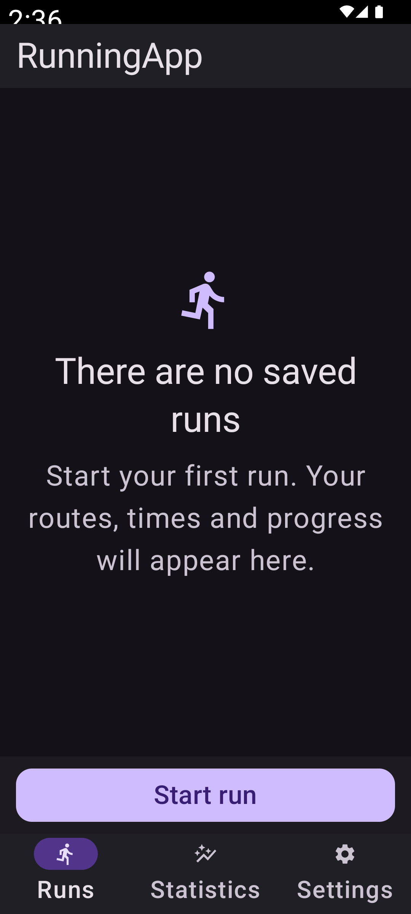
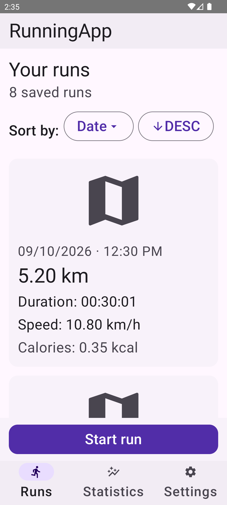
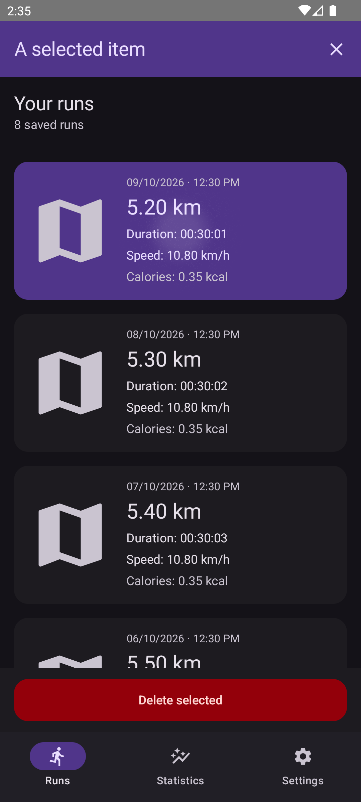

# Fase 3 — Shell y Carreras en Material 3

## Resultado

Implementada la pantalla piloto conservando la identidad morada. Toolbar y
navegación inferior M3, etiquetas visibles, superficies tonales y acciones
claras. No se modificaron tracking, base de datos, autenticación ni toolchain.

- Tarjetas adaptables: horizontal con letra normal; vertical con letra grande
  o ancho reducido. Sin altura fija para los textos.
- Selección mediante pulsación larga y toque, color tonal y semántica selected.
- Acción de iniciar/continuar o eliminar en una zona inferior reservada: la
  última tarjeta puede desplazarse sin quedar tapada por el botón.
- Filtros M3 con distribución flexible. Contrato nullable de ordenación intacto.
- Estado vacío más compacto; carga, error y reintento de Paging.
- Puente de snackbar M2→M3 para conservar los ScaffoldState compartidos.

## Verificación

Emulador Codex_UI_API_33, Android 13, 1080×2400, densidad 420.

| Comprobación | Resultado |
|---|---|
| testDebugUnitTest | 26 aprobadas, 0 fallos |
| assembleDebug + assembleDebugAndroidTest | Correcto |
| Suite instrumentada completa por adb | 20 aprobadas, 0 fallos |
| Nuevas pruebas fase 3 | 10 aprobadas |
| Tema claro/oscuro y fuente 100%/200% | Capturas y aserciones aprobadas |
| App real: Carreras vacío, Ajustes y Estadísticas | Navegación comprobada |

Las pruebas nuevas verifican toque/detalles, selección, actualización de unidades,
callbacks de filtros, navegación seleccionada, continuar/eliminar, reintento
tras error y listas completas en cuatro combinaciones de tema/tamaño de fuente.
Las listas usan ocho carreras ficticias en memoria, sin insertar datos en Room.
Los callbacks de eliminación y detalle se prueban como contratos de UI, no como
operaciones reales de borrado ni navegación end-to-end a Detalles.

Comandos usados: `:app:testDebugUnitTest :app:assembleDebug
:app:assembleDebugAndroidTest` y `adb shell am instrument -w
com.nullpointer.running.test/androidx.test.runner.AndroidJUnitRunner`.

## Capturas y análisis visual

Capturas bajo `docs/qa/material3-phase3/`.

Estado vacío legible, texto en varias líneas y acción sin invadir la navegación.
La fuente del reloj del sistema también aumenta; no es contenido de la app.

La tarjeta cambia a vertical y los controles no truncan su texto. El encabezado
permanece fijo: en pantallas más bajas conviene evaluar hacerlo desplazable.

Selección distinguible, textos con colores emparejados y eliminación separada.
Las capturas `*-bottom.png` acompañan la aserción de que el último elemento no
invade la acción inferior. `paging-error.png` documenta el error recuperable.

`before-light.png` es Ajustes antes de instalar: no es una comparación equivalente
del historial y no debe presentarse como un antes/después de Carreras.

## Correcciones verificadas

- InfoRun calculaba las métricas con remember sin claves: cambiar unidades podía
  dejar valores obsoletos. Ahora se derivan de los datos actuales; prueba de
  regresión cambia unidades sin recrear la composición.
- ListRuns desreferenciaba placeholders Paging con `!!`; ahora admite null.
- Eliminado el doble padding superior y reservado el espacio de la acción.
- Imagen de mapa ausente usa placeholder local en vez de imagen rota.

## Límites y siguiente fase

Tracking y formularios no migrados. Ajustes y Estadísticas solo reciben el shell;
su contenido y los paneles de permisos siguen con componentes anteriores.
No se verificó API 36, tablet, paisaje, TalkBack ni tracking real en movimiento.
El formateador preexistente de calorías se conservó: una fixture de 350 muestra
0.35 kcal; revisar su contrato de unidades por separado, no cambiarlo en una
migración visual. No hubo commit, publicación ni cambios de datos reales.

## Key Learnings:

1. El shell M3 puede conservar los ScaffoldState existentes mediante un host de
   snackbar adaptador, evitando migrar pantallas ajenas a la fase.
2. Los valores derivados de unidades deben recalcularse al cambiar MetricType;
   remember sin claves produce métricas visualmente obsoletas.
3. Las pruebas de UI con fixtures permiten validar selección y fuente 200% sin
   contaminar la base de datos del emulador.
